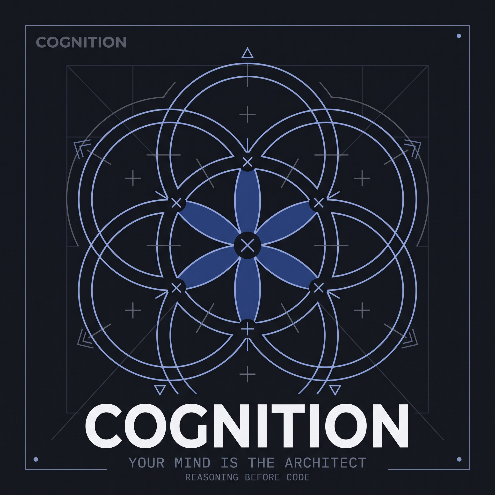

# Cognition

**Your mind is the architect.** Cognition is a plugin for **Claude Code** and **Codex** that enforces a reason-first workflow: the agent will not sketch a data model, pick a storage strategy, or scaffold an architecture until you've proposed one yourself.

It pushes back on weak spots, explains unfamiliar concepts, and waits for explicit confirmation before writing code. After implementing, it reports what it built and why, so you can verify the result against your own design instead of trusting the diff blindly.

Built for anyone who wants to stay in control of the thinking, not just the output: someone learning to program, a developer picking up an unfamiliar stack, or an experienced engineer who wants to keep "vibe coding" from replacing their own judgment.

## Table of Contents

- [Install](#install)
  - [npm (recommended)](#npm-recommended)
  - [As a Claude Code / Codex plugin](#as-a-claude-code--codex-plugin)
- [Commands](#commands)
  - [Session commands](#session-commands)
  - [Checkpoint responses](#checkpoint-responses)
  - [Spoken controls](#spoken-controls)
  - [Scripts](#scripts)
- [How a session runs](#how-a-session-runs)
- [Tuning it to you](#tuning-it-to-you)
- [Sharing with a team](#sharing-with-a-team)
- [Development](#development)
- [License](#license)

## Install

**Requirements:** [Node.js](https://nodejs.org/) 22.6+, and a current install of [Claude Code](https://code.claude.com/docs/en/setup) or [Codex](https://developers.openai.com/codex).

### npm (recommended)

Run this inside the project you want help with:

```sh
npx @craiggazimbi/cognition init
```

This vendors the skill guides straight into the project:

- `.claude/skills/cognition-*/` for Claude Code
- `.agents/skills/cognition-*/` for Codex and other AGENTS.md-reading tools
- A `SessionStart` hook merged into `.claude/settings.json`, if Claude Code is detected (a `CLAUDE.md` or an existing `.claude/`)

It's safe to run more than once — existing files are left alone and reported as kept.

Then start a session:

```text
/cognition-learn
```

(Codex: `$cognition-learn`.) Onboarding asks one question at a time — arrow keys and Enter to answer, or select **Use defaults** to skip to building. A new project and an unfamiliar existing codebase are both supported; for the latter, the agent reads the code first and summarizes what it found before asking anything.

The CLI checks npm once a day for a newer version (cached locally, non-blocking) and prints a notice when an update is available.

### As a Claude Code / Codex plugin

If you'd rather install through the native plugin system instead of npm:

```sh
claude --plugin-dir /absolute/path/to/cognition
```

or register it as a marketplace source with `/plugin marketplace add`, then `/plugin install cognition@cognition`. For Codex, add the directory as a local plugin source using Codex's own marketplace commands.

Commands are namespaced here instead of hyphenated: `/cognition:learn` (Codex: `$cognition:learn`). Behavior is otherwise identical to the npm install, and both tools read and write the same `.cognition/` folder in the project, so switching between them doesn't lose anything.

Wherever this guide shows a `/` command, use `$` in Codex.

## Commands

### Session commands

Run inside the project being worked on. There are four commands; everything else in this guide is either a picker option or plain language the agent interprets. Shown here in the npm-install form — see [As a Claude Code / Codex plugin](#as-a-claude-code--codex-plugin) for the namespaced form.

| Command | What it's for |
| --- | --- |
| `/cognition-learn` | Starts learning mode on a new project, or resumes it from existing `.cognition/` notes. Run once per session at the start, and again if the agent appears to have drifted out of learning mode (for example, after a long `/compact`). |
| `/cognition-status` | A read-only check: current learning mode, onboarding state, saved preferences, and any pending decision — without running Learn's full resume flow. Writes nothing. |
| `/cognition-pause` | Pauses learning mode immediately, equivalent to saying "pause learning." No confirmation step; fully reversed by running `/cognition-learn` again. Only the `Learning mode:` line changes. |
| `/cognition-reset` | Shows what's currently saved for the project, then — after explicit confirmation — backs up the current profile, progress, and project map, and restarts onboarding from scratch. Does not touch project code. |

### Checkpoint responses

Not typed commands — these are the options the agent presents at a checkpoint or reset. Selecting one, via the native picker or by name, advances the flow.

| Response | Appears at | Effect |
| --- | --- | --- |
| **Confirm and continue** | Design checkpoint | Locks in the proposed design and moves to the next open question. Still writes no code. |
| **Implement this step** | Implementation checkpoint | Authorizes the agent to write the code just described. Also counts as confirming the design, if not already confirmed. |
| **Discuss** | Either checkpoint | Raises questions or objections before committing — the agent waits for a reply instead of proceeding. |
| **Cancel** | `/cognition-reset` confirmation | Aborts the reset. Nothing changes, including the notes. |
| **Reset learning** | `/cognition-reset` confirmation | Confirms the reset: originals are backed up, then onboarding restarts. |

### Spoken controls

Plain language, said at any point in the conversation — no special syntax required. These tune how learning mode behaves without turning it off.

| Say this | To get |
| --- | --- |
| "Use fewer checkpoints." / "Use more checkpoints." | Light, Normal, or Frequent checkpoint frequency. |
| "Use multiple-choice questions." | Multiple-choice instead of open-ended reasoning questions. |
| "Focus on backend architecture." (or any area) | Narrows what the agent brings checkpoints to. |
| "Just implement this one." | Skips the checkpoint for one specific, trivial change. |
| "I'm stuck" / "skip" | Trades a reasoning question for an explanation or options, for that one step. |
| "Pause learning." | Same effect as `/cognition-pause` — suspends the whole loop — as plain language instead of a command. |

Resume a paused session the same way a session starts: `/cognition-learn`.

### Scripts

The agent invokes these through the CLI; running them directly isn't normally necessary. Documented here for completeness and for debugging.

| Command | What it takes |
| --- | --- |
| `npx @craiggazimbi/cognition status --cwd <path>` | Read-only. Prints the parsed profile fields and any pending decision as JSON. |
| `npx @craiggazimbi/cognition pause --cwd <path>` | Rewrites `Learning mode:` to `paused` in `profile.md`. |
| `npx @craiggazimbi/cognition reset --cwd <path>` | A read-only preview; add `--confirm <token>` (from that preview's output) to execute the reset. |
| `npx @craiggazimbi/cognition hook session-start` | Reads a `SessionStart` event from stdin and prints restoration instructions, or nothing. Used by the `SessionStart` hook automatically. |

`<path>` must be an absolute path to the project directory.

## How a session runs

Example: building a task tracker where one task can block another — "Deploy" can't start until "Write tests" is done.

**You:**

```text
Tasks can depend on other tasks. A task shouldn't be startable until everything it depends on is finished.
```

**Agent:**

```text
✦ Build checkpoint: Finished-but-reopened dependencies

Say "Deploy" depends on "Write tests," and "Write tests" is marked done.
Someone later reopens "Write tests" because they found a bug.

Should "Deploy" still be allowed to run, or does reopening a dependency
block anything that was waiting on it?
```

**You:**

```text
Reopening should re-block anything downstream. I don't want someone shipping on top of a dependency that's no longer actually finished.
```

**Agent:**

```text
That means a task's "can I start" status isn't fixed once dependencies are
met — it has to be re-derived whenever a dependency's status changes.

✦ Design checkpoint: Representing dependencies

Proposed: a dependencies table storing (task_id, depends_on_task_id) pairs,
with no status duplicated onto the dependent task. A task is startable only
if every row where it's the task_id points at a task marked done. Reopening
a task doesn't need to touch anything downstream — the startable check just
re-reads the live status each time it's asked.

This avoids a cached "ready" flag going stale. We still need to decide what
happens to a dependency pointing at a task that gets deleted.

❯ 1. Confirm and continue
     This approach makes sense to me; move to the next piece.
  2. Discuss
     Ask questions or clarify anything that doesn't make sense before deciding.
```

**You:**

```text
Confirm and continue.
```

*After working through task deletion the same way...*

**Agent:**

```text
✦ Implementation checkpoint: Dependency tracking and startability

I'll add the dependencies table, the startable check that re-derives status
from live dependency rows, and cascade the agreed delete behavior. Then I'll
test: a task blocked by an unfinished dependency, one unblocked after that
dependency completes, and one that re-blocks after its dependency reopens.

❯ 1. Implement this step
     This approach makes sense to me; write the code for this step.
  2. Discuss
     Ask questions or clarify anything that doesn't make sense before deciding.
```

**You:**

```text
Implement this step.
```

**Agent:**

```text
✦ Implementation report: Dependency tracking and startability

- Added the dependencies table and the query that derives startable status
  from current dependency state, instead of a stored flag.
- Wired task reopening to simply stop short-circuiting that query — no
  write-time cascade needed, since status is always re-derived on read.
- Added and ran three tests: blocked-by-open-dependency, unblocked-on-
  completion, re-blocked-on-reopen. All three passed.
```

You don't need to already know the answer going in. For an unfamiliar concept, the agent explains it and hands back a smaller, concrete question instead of the full design. You remain in control — answer in plain language, or say "skip" or ask for options when you want them.

What you describe sets the requirements, not the design. A Build checkpoint is where the mechanism gets worked out; stating a feature is not the same as choosing how it's built.

| Checkpoint | What happens |
| --- | --- |
| **Build** | The mechanism gets worked out with the agent's feedback — no code, no architecture yet. |
| **Design** | The agent lays out the proposed structure and tradeoffs. **Confirm and continue** locks it in and moves to the next open question; still no code. |
| **Implementation** | The agent names the exact change it's about to make. **Implement this step** is what authorizes it to write code. |

These don't have to happen as three separate stops — several Build checkpoints can collapse into one Design confirmation, and confirming readiness to implement also counts as confirming the design if not done separately. Either confirmation offers **Discuss** first, for questions or pushback before committing.

Once code is written, a short report follows: what changed, how the new code works, why it matches what was decided, what was tested (and what wasn't), and the actual result of running it — not just a claim that it works.

## Tuning it to you

Experience level changes how much is explained, not who decides:

| Level | What you get |
| --- | --- |
| Beginner | Concepts explained before they're used, small diagrams, narrower reasoning questions. |
| Intermediate | Less setup, more focus on how pieces interact and trade off against each other. |
| Advanced | Pressure-testing of constraints, edge cases, and unstated assumptions. |

Reasoning happens first at every level — experience only changes the scaffolding around it. Checkpoint frequency is adjustable separately:

- "Fewer checkpoints, please."
- "Multiple choice instead of open questions."
- "Just implement this one."
- "Pause learning," or run `/cognition-pause`. Resume anytime with `/cognition-learn`; check status in between with `/cognition-status`.

Preferences, progress, and a project map all live in a `.cognition/` folder at the project root (or at the Git repository root if one exists — Cognition locates it from any subdirectory). It survives restarts, `/clear`, and compaction. Add `.cognition/` to `.gitignore` to keep it out of version control; the plugin suggests this during onboarding but will not modify `.gitignore` without asking first.

Nothing here phones out: no account, no backend, no telemetry. Saved notes become part of the agent's context the same way any other file would, so your existing data settings for Claude Code or Codex apply unchanged.

`/cognition-reset` restarts a project from scratch. It shows exactly what it's about to touch, asks **Cancel** or **Reset learning**, and on confirmation moves the current profile, progress, and project map into a `backups/` folder before generating fresh ones. Nothing outside `.cognition/` is touched. A reset is not required just to change experience level or preferences — those can be changed directly.

## Sharing with a team

A plugin marketplace entry is just a pointer to a Git location — no public listing is required.

**Private repo.** Push a copy of this repository to a private Git host. Teammates with access run:

```sh
/plugin marketplace add your-org/cognition
/plugin install cognition@cognition
```

No publishing or review step is involved. Codex supports the equivalent command (`codex plugin marketplace add your-org/cognition`); check `codex plugin marketplace --help` for exact flags, since this surface is newer and documented less consistently than Claude Code's.

**Public repo.** Make the repo public. The same commands work for anyone who knows the repo path.

**Official directory listing.** Being discoverable without a direct link requires a separate, optional submission to Anthropic's curated marketplace — not required for private or link-based sharing.

Since `dist/` is committed in the repository, installs through the plugin system are immediate: a `node` runtime is sufficient, and the TypeScript toolchain is not required.

## Development

See [docs/development.md](docs/development.md) for the test suite, local checks, and the reasoning behind several implementation choices.

## License

[MIT](LICENSE) — use, modify, and share, including commercially, as long as the license notice stays with any copies. No warranty.
